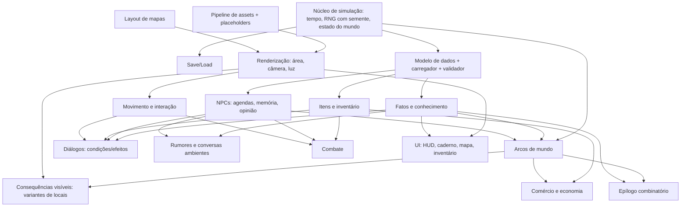

# PRD — ETRAVA

**Documento:** Product Requirements Document
**Versão:** 0.1
**Data:** 2026-11-09
**Status:** Proposta para especificação técnica e implementação
**Fontes:** *Ponto Seguro v0.2* (visão e filosofia — prioridade máxima) · *Os Nomes que Faltam — Bíblia narrativa v0.1* (lore provisória) · Diretrizes atualizadas do diretor (direção visual, restrições técnicas, MVP)

---

## 0. Como ler este documento

**Convenções de prioridade**

| Marcador | Significado |
|---|---|
| **[MVP]** | Obrigatório na primeira versão jogável. |
| **[MVP-S]** | Obrigatório no MVP em versão simplificada (a simplificação está descrita). |
| **[MVP-O]** | Opcional no MVP. Implementar só se os itens [MVP] estiverem concluídos e testados. |
| **[PÓS]** | Fora do MVP. A arquitetura não deve impedir; não implementar agora. |
| **[LP]** | Longo prazo / visão. Registrado para não ser perdido. |

**Identificadores**
- `RF-xxx` requisito funcional · `RNF-xxx` requisito não funcional · `AT-xx` teste de aceitação · `DP-xx` decisão provisória (pode ser revista) · `M-x` marco.

**Hierarquia em caso de conflito:** Diretrizes atualizadas do diretor > Ponto Seguro > Bíblia narrativa > este PRD > decisões do agente implementador. Quando este PRD contradiz um documento-fonte, a contradição é explícita e justificada (ver seção 19).

---

## 1. Visão executiva

**ETRAVA** é um RPG de mundo aberto de fantasia sombria, em Java, com câmera isométrica no espírito de Diablo I/II, ambientado em um mundo de civilizações profundamente diferentes onde os mortos ainda podem falar e o preço dos milagres é pago por gente que nunca soube que estava pagando.

O jogador controla uma pessoa comum. O mundo não espera por ela: NPCs têm rotinas, interesses e histórias que avançam sozinhas; acontecimentos políticos, econômicos e sobrenaturais ocorrem com ou sem participação do protagonista; as consequências persistem.

**Frase que define o projeto:**
> "Não queremos criar uma aventura em que o mundo espera pelo jogador. Queremos criar um mundo que possui suas próprias aventuras, e permitir que o jogador faça parte de algumas delas."

**Estratégia de produto:** construir primeiro **uma região pequena, densa e bonita** (Pedra-Mansa, Origem I, Capítulo I) com todos os sistemas fundamentais funcionando de verdade — mundo independente, rumores, escolhas persistentes, salvamento — e depois expandir por região, origem e capítulo sobre a mesma base.

**O MVP é um jogo pequeno e completo, não uma demo técnica.** Ele deve ser jogável do início ao fim do Capítulo I em 3 a 6 horas, com epílogo variável conforme o estado do mundo.

---

## 2. Identidade e experiência desejada

### 2.1 O que o jogador deve sentir
1. **"Esse lugar existia antes de mim."** Pessoas conversam entre si sobre coisas que não envolvem o jogador; lugares mostram marcas de histórias antigas.
2. **"Eu posso perder coisas — e tudo bem."** Oportunidades passam. Uma conversa ignorada na taverna pode ser a única pista. Mas o mundo continua interessante.
3. **"Ninguém me contou a verdade inteira."** Informação chega incompleta, distorcida, mentirosa ou sinceramente equivocada.
4. **"Minhas escolhas mudaram algo concreto."** Uma casa vazia, um preço diferente, um NPC que não cumprimenta mais, uma árvore que morreu.
5. **"Esse mundo é bonito, estranho e variado."** Dark fantasy sem ser um mundo inteiramente cinza e deprimente: há calor, humor, festas e beleza.

### 2.2 Pilares de experiência (ordem de prioridade do Ponto Seguro, §33)
1. Identidade visual marcante.
2. Civilizações profundas.
3. Mundo independente.
4. Narrativa ramificada.
5. Exploração e descoberta.
6. Personagens convincentes.
7. Sobrenatural misterioso.
8. Liberdade de experiência.
9. Combate funcional (importante, não central).
10. Tecnologia viável.

### 2.3 Tom
- Diálogos com subtexto, humor seco e tensão em situações banais (referência: Tarantino). Ninguém explica a história ao jogador.
- Equilíbrio emocional: histórias trágicas, ambíguas, felizes e engraçadas coexistem. **Regra: no conjunto de histórias de qualquer região, no máximo metade pode ter desfecho padrão trágico.**
- Aparência não indica moral: um lugar bonito pode esconder atrocidades; um lugar grotesco pode ser pacífico.

### 2.4 O que o jogo NÃO é (Ponto Seguro §35, condensado)
- Não é uma aventura do escolhido; o protagonista não é obrigado a virar herói, governante ou salvador.
- Não tem missões que existem só para o jogador, nem marcadores de objetivo.
- Não é um mapa grande e vazio.
- Não é um soulslike; combate difícil não é a atração.
- Não tem tecnologia moderna (sem eletrônicos, internet, carros modernos, armas nucleares).
- Não revela os grandes mistérios cedo.

---

## 3. Público-alvo e proposta de valor

**Público primário:** jogadores de PC (Windows) de 18+ anos que gostam de RPGs sistêmicos e narrativos — fãs de Kenshi, Disco Elysium, Pathfinder/Pillars, Diablo I/II, Mount & Blade, Dwarf Fortress/RimWorld pela emergência — e que valorizam lore e descoberta mais do que ação.

**Público secundário:** jogadores de RPG isométrico clássico atraídos pela estética.

**Proposta de valor:**
- Um mundo que **se move sozinho** e que o jogador **lê** por fragmentos, em vez de seguir uma trilha de missões.
- Um sobrenatural com **custo e política** (quem paga pelos milagres?), não apenas poderes.
- Liberdade real de **viver uma vida comum** dentro de uma época de transformações históricas.

**Classificação indicativa pretendida:** 16+ (violência, temas de morte, horror corporal em Nácre). Sem conteúdo sexual explícito.

---

## 4. Princípios fundamentais de game design

Estes princípios são regras de decisão. Quando o agente implementador tiver dúvida, deve escolher a opção que melhor respeita estes princípios.

| # | Princípio | Consequência prática |
|---|---|---|
| P1 | **O mundo não existe para o protagonista.** | Todo arco narrativo tem um desfecho padrão que ocorre sem o jogador (RF-141). |
| P2 | **Informação é conteúdo.** | O caderno registra *o que o personagem ouviu e viu*, não objetivos. Fatos têm fonte e podem ser falsos. |
| P3 | **Perder oportunidades é legítimo; ficar sem nada para fazer não é.** | Fatos importantes têm pelo menos 2 fontes; a região tem densidade mínima de conteúdo (seção 13). |
| P4 | **Consequência visível.** | Toda escolha marcada como relevante altera pelo menos 2 canais: ambiente, diálogo, economia, presença de NPC (RF-161). |
| P5 | **Simulação em escalas.** | Detalhe perto do jogador, abstração longe dele. Nada é simulado em detalhe sem necessidade. |
| P6 | **Dados, não código, para conteúdo.** | Histórias, diálogos, NPCs, itens e eventos vivem em arquivos de dados validados; adicionar uma história não exige mudar código. |
| P7 | **Ambição no universo, contenção na implementação.** | O modelo de dados prevê 30 civilizações; o MVP jogável mostra uma comunidade. |
| P8 | **Beleza antes de tamanho.** | Uma região menor e bonita vence uma maior e genérica. |
| P9 | **Mistério com evidência.** | Toda revelação futura deve ter pistas plantadas antes; nada arbitrário. |
| P10 | **Combate é ferramenta, não obrigação.** | Nenhum arco principal do MVP exige vencer um combate. |

---

## 5. Direção artística e apresentação visual

### 5.1 Análise das três abordagens

| Critério | **2D com sprites** (top-down/oblíquo) | **2.5D isométrico com sprites pré-renderizados/pintados** (Diablo II clássico) | **3D estilizado de baixa complexidade com câmera isométrica** |
|---|---|---|---|
| Velocidade de implementação do motor | Alta | Média (ordenação de profundidade, oclusão em grade iso) | Média (frameworks Java resolvem quase tudo) |
| Personagens animados com IA generativa | **Muito difícil** — manter o mesmo personagem consistente em 8 direções × várias animações é o ponto fraco atual das ferramentas de imagem | **Muito difícil** — mesmo problema, multiplicado pelas direções | **Viável** — usar personagens 3D já riggados e animados (pacotes livres/comerciais), sem Blender |
| Iluminação dinâmica, dia/noite, tochas, névoa | Exige normal maps e truques | Exige normal maps e truques; o look Diablo II era iluminação "pintada" | **Nativa** — e é o que mais gera atmosfera dark fantasy |
| Ambientes com IA (texturas, pinturas) | Excelente | Excelente para cenários pintados, ruim para variação de estado | Bom (texturas, decalques, céus, materiais) |
| Estados do mundo variáveis (casa abandonada, árvore morta) | Fácil (troca de sprite) | Exige re-renderizar/pintar | Fácil (troca de prop/material) |
| Futuras câmeras (livre, 3ª, 1ª pessoa) — visão original do Ponto Seguro | Impossível sem refazer | Impossível sem refazer | **Possível** sem refazer o mundo |
| Placeholders funcionais | Retângulos coloridos | Retângulos coloridos | Cápsulas/cubos coloridos |
| Proximidade com o visual de Diablo I/II | Média | **Máxima** | Alta, se a câmera, a paleta e a luz forem bem feitas (Diablo III/IV, Grim Dawn, Last Epoch, Path of Exile seguem esse caminho) |

### 5.2 Recomendação — DP-01

**Adotar 3D estilizado de baixa complexidade, apresentado com câmera isométrica (perspectiva fixa, distante, com zoom limitado).** Ou seja: *visual 2.5D, tecnologia 3D.*

**Justificativa:**
1. O maior gargalo de um projeto feito por agentes de IA com assets gerados por IA é **animação de personagens consistente**. Em 3D esse problema é resolvido com modelos já animados; em 2D/2.5D ele não tem solução confiável hoje.
2. **Iluminação dinâmica é a principal fonte de atmosfera** (raio de luz da tocha numa ruína, poeira dourada ao entardecer, névoa azul à noite). Em 3D isso é barato.
3. O sistema de **passagem do tempo** (dia/noite) e de **consequências visíveis** (variantes de props) fica trivial.
4. A câmera distante **esconde a baixa complexidade dos modelos** — é exatamente por isso que o isométrico é um bom casamento com 3D simples.
5. Preserva a visão original (câmera livre, 3ª e 1ª pessoa) como evolução possível, sem prometê-la.

**Limitações assumidas:**
- Risco de "cara de asset pack" (personagens genéricos, estilos misturados). Mitigação: guia de estilo rígido, paleta por cultura, pós-processamento unificado (gradação de cor, névoa, vinheta), texturas próprias geradas com o mesmo template de prompt.
- Personagens humanos devem ter **proporções naturais** (não chibi/cartunesco — Ponto Seguro §4). Isso restringe quais pacotes servem.

**Reversibilidade:** a separação obrigatória entre núcleo de simulação e renderização (RNF-010) permite trocar a camada visual por 2D no futuro sem refazer a lógica do jogo.

### 5.3 Câmera — DP-02
- Câmera isométrica com inclinação entre 35° e 50°, projeção perspectiva com campo de visão estreito (ou ortográfica — decisão técnica do implementador após teste visual).
- Segue o jogador com suavização; zoom em faixa limitada; rotação em passos de 90° **[MVP-O]**.
- Oclusão: paredes e telhados entre câmera e jogador ficam recortados/translúcidos; ao entrar em edifícios, o telhado some.
- **Primeira pessoa, terceira pessoa e câmera livre: [PÓS]/[LP].** A câmera deve ser um componente substituível (RF-024).

### 5.4 Direção artística inicial — "Gótico pintado"
Referência-síntese: **a luz e a sujeira de Diablo II, a variedade cultural de Warhammer, com materiais e silhuetas que dizem a cultura antes do texto.**

**Regras gerais**
1. **Leitura a distância:** silhuetas de personagens, props e edifícios devem ser reconhecíveis na distância padrão da câmera. Detalhe fino é desperdício.
2. **Luz conta a história:** fontes de luz quentes (lamparinas, fornos, velas) contra ambiente frio à noite; dia com luz suave e poeira em suspensão.
3. **Textura pintada, não fotográfica:** texturas com aparência de pintura a óleo/guache, ruído controlado, sem fotorrealismo.
4. **Saturação controlada:** a maior parte da tela em tons dessaturados; cor forte reservada para significado (fogo, sangue, bioluminescência, estandartes).
5. **Escuridão é lugar, não regra:** ruínas, porões e noites são escuros; vilarejo ao meio-dia é quente e vivo.

**Paletas por cultura (provisórias, para o guia de estilo)**

| Cultura | Materiais | Paleta | Luz característica |
|---|---|---|---|
| **Pedra-Mansa / Terras de Ferrugem (interior)** | pedra irregular, madeira gasta, ferro oxidado, palha | ocre, ferrugem, verde-oliva desbotado, cinza quente | sol poeirento; lamparinas âmbar à noite |
| **Caldris** | tijolo, ferro fundido, latão, fuligem | vermelho-tijolo, preto-fuligem, latão | brasa de fornalha, névoa industrial |
| **Selvar** | mármore, bronze, tecidos finos | branco-mármore, azul profundo, dourado | luz clara e limpa, sombras nítidas |
| **Orra** | pedra cinza, linho, prata, cera | cinza-pedra, branco-linho, prata, vermelho-litúrgico | velas, vitrais, frio |
| **Nácre** | osso, membrana, cartilagem, resina | marfim, rosa-carne, âmbar translúcido, verde-bioluminescente | luz filtrada por membranas, bioluminescência |
| **Cantões do Sal** | sal cristalizado, madeira de barco, toldos | branco-sal, turquesa, tecidos coloridos | sol forte, reflexos brancos |

No MVP apenas a primeira linha é produzida em qualidade final; as demais aparecem em ilustrações (mapa, retratos de viajantes, objetos estrangeiros).

### 5.5 Onde a IA generativa entra (e onde não entra)

| Uso | Ferramenta típica | Adequação |
|---|---|---|
| Retratos de NPCs para diálogos | Geração de imagem (ex.: Dreamina) | **Alta** — grande retorno visual |
| Ícones de itens | Geração de imagem | Alta |
| Texturas de terreno, paredes, madeira, tecidos | Geração de imagem + ajuste para *tileable* | Alta |
| Ilustrações de mapa, tela de carregamento, menu, documentos | Geração de imagem | Alta |
| Arte conceitual por cultura (referência para consistência) | Geração de imagem | Alta |
| Ambiente sonoro, efeitos, música | Ferramentas de áudio por IA ou bancos livres | Média/Alta |
| Modelos 3D de personagens animados | **Não depender de IA.** Usar pacotes prontos já riggados | — |
| Props 3D | Pacotes prontos; ferramentas imagem→3D **apenas se verificadas** | Média |

---

## 6. Estrutura do mundo e exploração

### 6.1 Visão de longo prazo [LP]
- Um continente (ou mais) com dezenas de regiões e ~30 culturas, das quais 6 grandes potências iniciais: **Caldris, Selvar, Orra, Nácre, Cantões do Sal, Terras de Ferrugem**.
- Mistura de regiões feitas à mão (cidades, monumentos, ruínas com história) e áreas semiautomáticas (terreno, vegetação).
- Muitas sociedades isoladas que desconhecem umas às outras.

### 6.2 Estrutura técnica do mundo
- **Mundo → Regiões → Locais → Áreas.**
  - *Região:* unidade política/cultural (ex.: interior das Terras de Ferrugem).
  - *Local:* lugar nomeado (Pedra-Mansa, Posto da Encruzilhada).
  - *Área:* espaço jogável carregado de uma vez (o vilarejo exterior, o interior da taverna, a ruína).
- Regiões e locais **existem como dados mesmo sem área jogável**; a simulação abstrata e os rumores podem referenciá-los (ex.: Fornal, capital de Caldris, existe no MVP só como dado e como assunto).

### 6.3 Região do MVP — Pedra-Mansa e arredores
| Área | Conteúdo | Observação |
|---|---|---|
| **Pedra-Mansa (exterior)** | ~15 construções: oficina de Avel, taverna, moinho, casas, poço, praça, campos, pomar, a árvore de Nalia, cemitério pequeno | Coração do MVP. Densidade máxima. |
| **Interiores** | oficina/casa de Avel, taverna, moinho, 2–3 casas | Interiores simples, alta qualidade de luz |
| **Arredores** | campos, divisa disputada, bosque ralo, estrada | Animais selvagens, coleta |
| **Estrada e Posto da Encruzilhada** | Posto de troca de mercadores dos Cantões do Sal, ponto de passagem de viajantes | Fonte de notícias externas e comércio |
| **A estrutura enterrada** (gancho 03) | Pequena ruína subterrânea revelada durante um trabalho; corredores com fibras orgânicas petrificadas e símbolos | Única área "dungeon" do MVP; luz limitada; primeira pista física (não explicada) da Sutura |

**Tamanho de referência:** o exterior completo deve ser atravessável a pé em ~3–4 minutos reais. Melhor menor e cheio do que maior e vazio.

### 6.4 Autoria de mapas — DP-03
O usuário não usa Blender e os mapas serão montados majoritariamente por agentes. Recomenda-se:
- **Layout em editor de mapas 2D consolidado** (ex.: *Tiled*, gratuito e maduro) com camadas de terreno, colisão, navegação e objetos; o jogo converte o layout em cena 3D, posicionando props por ID.
- **Alternativa aceitável:** modo de edição interno simples (posicionar/rotacionar props e salvar em arquivo de dados).
- Em ambos os casos o resultado é **arquivo de dados versionável**, editável por humanos e por IA.

---

## 7. Sistemas e mecânicas principais

Resumo da decisão por sistema. Os requisitos detalhados estão na seção 11.

| # | Sistema | Decisão para o MVP | Pós-MVP |
|---|---|---|---|
| 1 | Exploração e movimentação | **[MVP]** Clique para mover (pathfinding) + WASD alternativo; interação contextual; transição entre áreas | Viagem rápida com custo de tempo; montarias/veículos rudimentares |
| 2 | Câmera e apresentação | **[MVP]** Isométrica fixa, zoom, oclusão; rotação 90° [MVP-O] | Câmera livre, 3ª e 1ª pessoa |
| 3 | Mundo e regiões | **[MVP]** 1 região jogável, demais como dados | Novas regiões por expansão |
| 4 | Civilizações e facções | **[MVP-S]** Modelo de dados completo; 4 facções locais ativas | Política regional simulada |
| 5 | NPCs, rotinas e relacionamentos | **[MVP]** NPCs em camadas, rotinas, memória, opinião | Ambições próprias que geram eventos, NPCs que crescem em importância |
| 6 | Diálogos e interações | **[MVP]** Árvores orientadas a dados com condições/efeitos; conversas ambientes audíveis | Cutscenes encenadas, diálogos em grupo |
| 7 | Histórias, rumores, descobertas | **[MVP]** Sistema de fatos/conhecimento, caderno, propagação de rumores | Distorção avançada, imprensa/proclamações |
| 8 | Eventos independentes | **[MVP]** Arcos de mundo como máquinas de estado; eventos externos agendados | Gerador sistêmico de eventos, crises regionais |
| 9 | Escolhas e consequências | **[MVP]** Estado de mundo persistente; epílogo combinatório do capítulo | Final de campanha combinatório |
| 10 | Progressão e habilidades | **[MVP-S]** 6 habilidades por uso; conhecimento como progressão | Traços, especializações, aprendizado com mestres |
| 11 | Inventário e equipamentos | **[MVP-S]** Lista com peso, 5 slots de equipamento | Durabilidade, criação de itens |
| 12 | Combate | **[MVP-S]** Tempo real estilo Diablo, simples, com fuga/rendição | Mais habilidades, grupos, armas à distância |
| 13 | Magia e sobrenatural | **[MVP-S]** Jogador **não** conjura; sobrenatural como eventos com custo | Práticas por civilização com custo e transferência |
| 14 | Comércio e economia | **[MVP-S]** Moeda única, comerciantes com estoque, modificadores de preço por eventos, trabalho remunerado | Caravanas, rotas, múltiplas moedas, propriedades |
| 15 | Reputação e influência | **[MVP-S]** Opinião individual + reputação comunitária propagada por rumor | Influência política, cargos |
| 16 | Companheiros | **[PÓS]** (no MVP: acompanhante temporário roteirizado [MVP-O]) | Companheiros com agenda, lealdade, partida |
| 17 | Passagem do tempo | **[MVP]** Relógio, dia/noite, esperar/dormir, simulação correta em saltos | Estações, calendário cultural |
| 18 | Morte do personagem | **[MVP-S]** Derrota não letal na maioria dos casos; morte real em situações explícitas | Sucessão por personagem ligado |
| 19 | Salvamento | **[MVP]** Manual + automático, estado completo, versionado | Ironman, nuvem |
| 20 | Interface | **[MVP]** HUD mínimo, caderno, mapa, inventário, diálogo, comércio | — |
| 21 | Áudio | **[MVP-S]** Ambientes por área/período, poucas músicas, efeitos, sem dublagem | Dublagem parcial, murmúrios por idioma |
| 22 | Assets | **[MVP]** Pipeline com IDs lógicos, placeholders automáticos, guia de estilo | Ferramentas de importação adicionais |

### 7.1 Exploração
Explorar é **observar e escutar**, não só andar. O que a exploração entrega no MVP:
- Conversas ambientes audíveis ao passar (fonte de rumores).
- Objetos inspecionáveis com texto curto (um túmulo, uma placa, um papel).
- Locais nomeados descobertos (registrados no caderno e no mapa).
- Mudanças visíveis do mundo ao longo dos dias.

### 7.2 Trabalho e vida comum
Viver no mundo é uma opção válida (P1, Ponto Seguro §16). No MVP o jogador pode:
- Trabalhar na oficina de Avel (tarefas diárias), carregar mercadorias no Posto, ajudar na colheita.
- Cada trabalho: ação que consome tempo de jogo, paga, aumenta a habilidade relacionada e gera **pequenas interações** (o trabalho é também onde se ouvem coisas).
- **Simplificação:** trabalho é uma ação temporizada com resultado influenciado por habilidade, sem minijogo. [MVP-S]

### 7.3 Combate
- Tempo real, clique no alvo para atacar, inspirado em Diablo. Vida e fôlego.
- Inimigos humanos podem fugir ou se render; o jogador pode poupar, roubar, ameaçar.
- Encontros no MVP: animais na estrada/bosque à noite, saqueadores na estrada, ameaça dentro da estrutura enterrada (a definir, ver Q-07).
- Preparação importa (equipamento, fôlego, hora do dia), reflexo não.

### 7.4 Magia e sobrenatural
- O sobrenatural é **real, custoso e mal compreendido**.
- No MVP o jogador **observa** o sobrenatural (Nalia e a árvore, a estrutura enterrada, o rumor de Berta) e pode **interferir** nas consequências, mas não lança feitiços. — **DP-04**. Justificativa: o Ponto Seguro pede que o sobrenatural seja revelado aos poucos e que o jogador comece com pouco conhecimento; um sistema de magia completo no MVP contradiz isso e custa caro.
- O modelo de dados do "custo" (tipo, quem paga, origem, destino) deve existir desde o MVP para suportar a mecânica central futura: **custos transferidos para terceiros**.

---

## 8. Narrativa, origens e ramificações

### 8.1 Cânone adotado (provisório)
Do documento de lore, este PRD adota como base, sujeito a revisão:
- **O mundo se chama Etrava; o jogo se chama ETRAVA.** "Os Nomes que Faltam" fica como possível subtítulo ou nome do tema central (DP-05).
- **A Sutura:** rede subterrânea orgânico-mineral que preserva experiências e consciências; base da magia, da medicina extraordinária e da necromancia.
- **A Primeira Escuta** (~400 anos antes) e a **Segunda Escuta** (Capítulo V).
- **A troca equivalente é real, mas os custos são redirecionáveis** — e a Concordata dos Nove os redireciona para comunidades sem poder.
- **Concordata dos Nove:** originalmente nove comunidades cooperativas (com as consciências preservadas como partes do acordo); hoje uma estrutura hereditária que usurpou o nome.
- **A Testemunha** e a **Convergência** como ameaça/possibilidade final.
- **Mir** (24 anos antes): ruptura da Câmara de Distribuição; Iria (mãe), Taren (pai), Avel (falso tio).
- Os seis personagens-motores do mundo: **Mara Voss, Seril Namar, Edda Varen, Naor Selen, Ramil Dorsa, Torek Vann**, mais **Silas Noren** e **Nalia**.
- **Cinco capítulos** como estágios de descoberta, não trilhos: I *As coisas pequenas*, II *As fronteiras dos homens*, III *Os que não aceitaram morrer*, IV *A história que foi enterrada*, V *Quando a terra respondeu*.
- **Sete grandes estados finais** (Livro Aberto, Portas Seladas, Segunda Concordata, Uníssono, Mercado das Almas, Mundos Separados, Mundo Sem o Protagonista), cada um com variações combinatórias.

### 8.2 Camadas de verdade
Para impedir revelação precoce, o conteúdo é classificado em camadas. **Cada fato no banco de dados deve ter uma camada.**

| Camada | Conteúdo | Pode aparecer em |
|---|---|---|
| **V0 — Superfície** | Vida cotidiana, rumores locais, política visível, fenômenos estranhos sem explicação | Capítulo I+ (MVP) |
| **V1 — Suspeita** | Existência de algo sob a terra; custos que "vão para outro lugar"; Mir como acidente encoberto | Pistas no MVP; desenvolvimento no Cap. II–III |
| **V2 — Estrutura** | Transferência deliberada de custos; Concordata; papel de Iria e Avel | Cap. III–IV |
| **V3 — Fundação** | Origem da Sutura, direitos apagados das consciências, a Testemunha, natureza da consciência | Cap. IV–V |

**Regra para o MVP:** nenhum fato V2 ou V3 pode ser apresentado como verdade confirmada. Fatos V1 só aparecem como pistas ambíguas (um símbolo, um nome, uma fala interrompida, um documento queimado).

### 8.3 Refinamentos de coerência na lore (propostos)

| # | Problema identificado | Solução provisória | Justificativa |
|---|---|---|---|
| L1 | Pedra-Mansa fica no interior das **Terras de Ferrugem**, descritas como sem instituições estáveis. Então quem manda a "comitiva de autoridades para atualizar registros de propriedade"? | **DP-06:** a comitiva é de **agrimensores e registradores de Caldris**, demarcando o traçado da ferrovia e "atualizando registros" de terras que Caldris pretende reivindicar. Funde o gancho 02 (*A cobrança*) com o arco da ferrovia. Um dos funcionários procura, por motivo próprio, antigos moradores de Mir. | Liga o vilarejo ao conflito internacional sem centralizar o protagonista. Alternativa registrada: comitiva da rota protegida de Torek Vann. |
| L2 | Mir foi há 24 anos e o protagonista é "jovem aprendiz". | O protagonista era bebê ou criança pequena em Mir; tem **~24–27 anos**. Avel levou "algumas crianças": as outras existem em algum lugar (gancho para origens/capítulos futuros). | Mantém a linha do tempo da lore. |
| L3 | "Tio" é um título falso. | Avel não é parente de sangue; isso é segredo V1 (pode ser descoberto no MVP só como suspeita). | Coerente com a lore. |
| L4 | O Ponto Seguro pede ~30 civilizações; a lore define 6 potências. | Adotar as 6 como núcleo narrativo; o modelo de dados aceita qualquer número; novas culturas entram por expansão. | Não reduz a ambição, só a sequencia. |
| L5 | O Ponto Seguro pedia 3D realista estilo Kenshi; a diretriz atualizada pede isometria estilizada. | A diretriz atualizada prevalece (DP-01). Proporções humanas naturais são mantidas. | Hierarquia de documentos. |
| L6 | A lore tem 5 capítulos; o Ponto Seguro deixa o número em aberto. | Adotar 5 como estrutura provisória; o sistema de capítulos não assume quantidade fixa. | Flexível. |
| L7 | A lore traz muitos arcos sombrios; o Ponto Seguro exige equilíbrio. | O MVP inclui obrigatoriamente histórias leves (seção 8.5). | Ponto Seguro §22. |
| L8 | O "ladrão de frutas" é só uma linha na lore. | Usar como história de **explicação surpreendentemente simples** (ex.: uma criança alimentando um animal escondido). Resolução exata fica a critério do roteiro. | Ponto Seguro §22: "algumas podem parecer horríveis e ter explicações simples". |

**Não decidido aqui (para não inventar cânone definitivo):** o que exatamente existe na estrutura enterrada; a identidade do estranho que procura alguém de Mir; nomes dos NPCs menores (todos os nomes novos neste PRD são provisórios).

### 8.4 Origens
| Origem | Região | Status |
|---|---|---|
| **I — O aprendiz de Pedra-Mansa** | Interior das Terras de Ferrugem | **[MVP]** |
| II — O operário de Fornal | Caldris | [PÓS] |
| III — O auxiliar do Arquivo | Selvar | [PÓS] |
| IV — O aprendiz do Sacrário | Orra | [PÓS] |
| V — O jovem da rota comercial | Cantões do Sal | [PÓS] |

**Regra (Ponto Seguro §17):** as origens não podem ser cinco versões da mesma história. Elas compartilham o mundo e o calendário de eventos, não a trama.

**Requisito arquitetural:** "origem" é um pacote de dados (local inicial, personagem, relações iniciais, conhecimentos iniciais, arcos pessoais). Adicionar uma origem não exige código novo.

### 8.5 Conteúdo narrativo do MVP (Capítulo I em Pedra-Mansa)

**Arcos maiores (dirigidos pelo mundo)**

**A1 — Nalia e a árvore** (gancho 08)
- Nalia, filha do moleiro, restaura a árvore sob a qual a mãe falecida costumava descansar. O vilarejo comemora; depois ela deixa de dormir, ouve vozes à noite.
- Estágios (dias aproximados, ajustáveis): restauração (d2) → insônia (d4–6) → vozes (d8) → família procura ajuda; curandeira diz que a árvore "tira algo dela", outro morador propõe destruir a árvore, Nalia se recusa (d10) → resolução (até ~d18).
- Intervenções possíveis: investigar; descobrir (com a curandeira, com pistas da estrutura enterrada ou de um viajante) que o custo pode ser **dividido entre voluntários**; convencer voluntários; ajudar a cortar a ligação (a árvore morre de novo); apoiar a destruição; não fazer nada.
- **Desfecho padrão sem o jogador:** decidido pelo estado do mundo (ex.: o pai corta a árvore — Nalia se recupera parcialmente, luto; ou um estudioso de passagem estabiliza a situação se certas condições do mundo ocorrerem). Pelo menos um desfecho não trágico precisa ser alcançável **sem** o jogador.
- Importância: é a **primeira evidência (V1)** de que custos sobrenaturais podem ser distribuídos.

**A2 — A comitiva e o segredo de Avel** (arco pessoal)
- Chega um **estranho** procurando alguém que trabalhou em Mir (gancho 01 adaptado). Avel finge não conhecê-lo.
- A **comitiva de Caldris** chega para demarcar terras e atualizar registros (DP-06). Um funcionário pergunta por antigos moradores de Mir. Avel fica desconfortável.
- O jogador pode notar ou não; investigar a oficina e encontrar documentos com informações contraditórias (nomes, datas, uma assinatura de "Iria").
- Avel recebe uma carta (~d14). Conforme o estado do mundo e a relação com o jogador: parte durante a noite deixando um bilhete; fica e é levado para "averiguação"; confessa uma **parte** da verdade (só com relação alta + documentos encontrados); ou é encontrado pelo estranho.
- **Limite de revelação no MVP:** Mir é nomeada como "o acidente"; Iria é um nome; nada confirma V2.

**A3 — A estrutura enterrada** (gancho 03)
- Durante um trabalho (poço, fundação ou campo), surge uma estrutura antiga. Avel reconhece símbolos e evita explicar.
- Área explorável curta, com luz limitada e algum perigo. Rende objetos, fragmentos de texto e um "eco" sonoro inexplicável.
- Não explica nada. Planta pistas para A1 (custos) e para o futuro.

**Histórias menores (obrigatórias para tom e densidade)**
- **H1 — O ladrão de frutas** (vizinha reclama; explicação simples e leve).
- **H2 — A divisa** (dois agricultores disputam uma faixa de terra; a demarcação da comitiva pode resolver ou piorar a disputa — cruzamento entre histórias pequenas e grandes).
- **H3 — Os apostadores da taverna** (Cena 1 da lore; humor; fonte natural de rumores; jogo de aposta simples [MVP-O]).
- **H4 — O trabalho temporário** (comerciante do Posto oferece trabalho: carregar, vigiar ou acompanhar um carregamento até o fim da estrada; pode envolver saqueadores).
- **H5 — A festa** (uma comemoração local, feliz; durante ela alguém diz algo aparentemente absurdo que dias depois se revela verdadeiro — gancho 30. Ex.: que a ferrovia vai passar pelo cemitério).

**Notícias do mundo (eventos externos que chegam por rumor)**
- **E1** Caldris aprova os primeiros projetos da ferrovia.
- **E2** O preço do sal medicinal sobe (afeta preços no Posto e o acesso a remédios no vilarejo).
- **E3** Um importante sacerdote de Orra desaparece em viagem.
- **E4** A mulher que atravessou o incêndio (Berta) — história que **evolui em outro lugar** e chega em versões diferentes ao longo dos dias; o jogador nunca a vê no MVP, mas as versões mudam conforme o arco avança fora de tela.
- **E5** Torek Vann tenta unificar comunidades (rumor sobre "um homem que cobra pela segurança da estrada").

### 8.6 Capítulos como sistema
- Capítulo é um **estado global** com condições de entrada, não uma fase obrigatória.
- Capítulo I termina quando o personagem adquire experiência relevante fora da realidade inicial (ex.: deixa a região com certo conhecimento ou vínculos), **ou** por tempo limite do MVP.
- **No MVP:** ao atingir a condição de saída (deixar Pedra-Mansa pela estrada com intenção declarada — ex.: aceitar seguir uma caravana, ir atrás de Avel) **ou** chegar ao dia 30, o jogo apresenta o **epílogo do Capítulo I** e permite continuar livremente na região.

### 8.7 Ramificações e finais
- Finais são **combinatórios**: o epílogo é montado com fragmentos condicionais sobre o estado do mundo (quem está vivo, o que aconteceu com Nalia, onde está Avel, o que o jogador sabe, reputação, dinheiro, relações, eventos externos).
- "Bilhões de finais" (Ponto Seguro §25.1) é tratado como **consequência da combinação de estados**, não como meta numérica. A meta é variedade **perceptível**.
- MVP: epílogo com pelo menos 15 fragmentos condicionais, cobrindo os arcos A1–A3, H1–H5 e a situação pessoal do protagonista (RF-163).

---

## 9. NPCs e mundo dinâmico

### 9.1 NPCs em camadas — DP-07
| Camada | Quem | Simulação | MVP (quantidade) |
|---|---|---|---|
| **A — Personagens** | Envolvidos em arcos (Avel, Nalia, o moleiro, a curandeira, o estranho, chefe da comitiva…) | Rotina, memória, opinião, conhecimento, objetivos, participação em arcos | 8–12 |
| **B — Moradores** | Habitantes com nome e profissão | Rotina, opinião, conhecimento (rumores), falas ambientes | 10–15 |
| **C — Figurantes** | Viajantes, mercadores de passagem, trabalhadores do Posto | Comportamento simples, falas genéricas, podem portar notícias | 5–15 simultâneos |

Total de NPCs nomeados no MVP: **~20–25.** (A lore fala em ~100 habitantes; o MVP representa uma comunidade menor ou parte dela. DP-08.)

### 9.2 Rotinas
- Agenda por blocos de horário (dormir, trabalhar, comer, taverna, culto/visita, lazer) associada a locais.
- Rotinas são interrompidas por eventos de arco (ex.: o moleiro vai à curandeira) e por reação a situações (chuva, briga, morte).
- Quando um NPC sai do arco (morre, parte), **sua ausência é persistente e comentada**.

### 9.3 Memória, opinião, conhecimento
- **Memória:** registros datados de eventos relevantes envolvendo o jogador ou outros NPCs ("viu o protagonista pegar algo do baú do moleiro, dia 6").
- **Opinião:** valor −100 a +100 sobre o jogador e sobre outros NPCs selecionados.
- **Conhecimento:** conjunto de fatos que o NPC sabe ou acredita (com possível versão distorcida). NPCs compartilham fatos entre si conforme rotinas e relações → **rumores**.

### 9.4 Mundo dinâmico — simulação em escalas
| Escala | Escopo | Frequência | MVP |
|---|---|---|---|
| Detalhada | Área carregada | Contínua | [MVP] |
| Abstrata local | Outras áreas da região | Por bloco de tempo (ex.: hora de jogo) | [MVP] |
| Arcos de mundo | Histórias da região e externas | Avaliação periódica (ex.: a cada hora de jogo) + gatilhos | [MVP] |
| Política/economia regional | Facções, preços, guerras | Diária | [MVP-S] (só modificadores de preço e relações) / [PÓS] (simulação) |

---

## 10. Interface e experiência do jogador

### 10.1 Princípios de UI
- **Diegética quando possível, mínima sempre.** Sem marcadores de missão, setas ou pontos de exclamação.
- **O caderno substitui o diário de missões.** Ele registra *o que o personagem sabe*, com fonte, não *o que ele deve fazer*.
- Estética: papel envelhecido, tinta, bordas sóbrias; tipografia serifada legível; nada de UI "neon".

### 10.2 Telas do MVP
| Tela | Conteúdo |
|---|---|
| Menu principal | Novo jogo, continuar, carregar, opções, sair. Arte de fundo (IA). |
| Novo jogo | Seleção de origem (MVP: apenas Origem I disponível), nome do personagem, ritmo de eventos (RF-145). |
| HUD | Vida, fôlego, hora/dia (relógio discreto), atalhos de habilidade de combate, indicador de interação ao passar o mouse. |
| Diálogo | Retrato, nome, fala, escolhas numeradas; histórico rolável da conversa. |
| Legendas ambientes | Falas de NPCs próximos aparecendo sobre eles (balões curtos) e em registro rolável. |
| Caderno | Abas: *Ouvi dizer*, *Vi*, *Pessoas*, *Lugares*, *Documentos*. Entradas com dia e fonte. Jogador pode marcar entradas de interesse. |
| Mapa | Ilustração da região com locais descobertos; posição do jogador. Sem objetivos marcados. |
| Inventário/Equipamento | Lista por categoria, peso, slots, comparação simples. |
| Personagem | Habilidades com valor e descrição. |
| Comércio | Duas colunas, preço, dinheiro de ambos, efeito da opinião. |
| Opções | Áudio, vídeo, controles, texto, ritmo de eventos. |
| Salvar/Carregar | Slots com miniatura, dia de jogo, local, tempo jogado. |
| Epílogo | Sequência de painéis ilustrados com texto montado pelo estado do mundo. |

### 10.3 Controles (Windows, mouse + teclado)
- Clique esquerdo: mover/interagir/atacar · Clique direito: habilidade selecionada · WASD: mover (alternativo) · Roda: zoom · Q/E: rotacionar câmera [MVP-O] · 1–2: habilidades · I: inventário · J ou N: caderno · M: mapa · C: personagem · Espaço: pausar · Esc: menu · F5/F9: salvar/carregar rápido · T: esperar.
- Controle remapeável: [PÓS]. Gamepad: [PÓS].

---

## 11. Requisitos funcionais

### 11.1 Exploração e movimentação
| ID | Requisito | Prior. |
|---|---|---|
| RF-001 | O jogador move o personagem clicando no terreno; o personagem segue um caminho válido contornando obstáculos. Clique em ponto inalcançável leva ao ponto alcançável mais próximo. | MVP |
| RF-002 | Movimento alternativo por WASD relativo à orientação da câmera. | MVP |
| RF-003 | Alternância andar/correr; correr consome fôlego fora de combate apenas se o implementador julgar necessário. | MVP |
| RF-004 | Ao passar o mouse sobre NPC/objeto interativo, ele é destacado e mostra nome/ação. Clique executa a ação se dentro do alcance; senão o personagem se aproxima e executa. | MVP |
| RF-005 | Transições entre áreas (portas, entrada da estrutura enterrada, estrada) carregam a nova área em ≤ 5 s no hardware de referência, com tela de transição. | MVP |
| RF-006 | Ao entrar em edifício, o telhado/andar superior fica oculto; ao sair, volta. | MVP |
| RF-007 | Entrar em um local nomeado pela primeira vez registra-o no caderno e no mapa. | MVP |
| RF-008 | Áreas escuras (estrutura enterrada, noite sem luz) limitam a visibilidade a um raio de luz em torno do personagem, aumentado por lamparina/tocha equipada. | MVP-S |
| RF-009 | Objetos inspecionáveis exibem texto curto; alguns geram fatos no caderno. | MVP |
| RF-010 | Viagem rápida entre locais descobertos, consumindo tempo de jogo proporcional à distância. | PÓS |

### 11.2 Câmera e apresentação
| ID | Requisito | Prior. |
|---|---|---|
| RF-020 | Câmera isométrica que segue o jogador com suavização. | MVP |
| RF-021 | Zoom em faixa limitada definida por configuração. | MVP |
| RF-022 | Rotação da câmera em passos de 90°. | MVP-O |
| RF-023 | Geometria que oculta o jogador fica translúcida ou recortada. O jogador nunca fica invisível por mais de 0,5 s sem indicação (silhueta). | MVP |
| RF-024 | A câmera é um componente substituível; o restante do jogo não assume ângulo fixo em sua lógica (ex.: interação usa posição de mundo, não de tela). | MVP |
| RF-025 | Em diálogos importantes a câmera pode aproximar/enquadrar os participantes. | MVP-O |
| RF-026 | Câmera livre, terceira pessoa e primeira pessoa. | PÓS/LP |
| RF-027 | Ciclo de iluminação dia/noite: posição/cor da luz principal, cor ambiente, névoa e gradação de cor variam com a hora. | MVP |
| RF-028 | Pós-processamento unificado: gradação de cor por área/período, vinheta, névoa; bloom sutil opcional. Cada efeito pode ser desligado nas opções. | MVP-S |

### 11.3 Mundo e regiões
| ID | Requisito | Prior. |
|---|---|---|
| RF-040 | Mundo definido por dados: regiões, locais e civilizações existem como registros independentemente de terem área jogável. | MVP |
| RF-041 | Região jogável do MVP com as áreas listadas em 6.3. | MVP |
| RF-042 | Áreas são construídas a partir de arquivos de layout (DP-03), não codificadas à mão. | MVP |
| RF-043 | Props e locais têm **variantes de estado** controladas pelo estado do mundo (ex.: árvore viva/morta/cortada; casa habitada/abandonada; estacas de demarcação presentes/ausentes). | MVP |
| RF-044 | Cada área tem nível de perigo por período (dia/noite), que controla a geração de encontros hostis. | MVP-S |
| RF-045 | Clima simples (céu limpo, nublado, chuva) com efeito visual e sonoro, influenciando rotinas. | MVP-O |

### 11.4 Civilizações e facções
| ID | Requisito | Prior. |
|---|---|---|
| RF-060 | Modelo de dados de **civilização** com: identidade histórica, religião/filosofia, governo, economia, estrutura social, costumes, arquitetura/paleta, relação com magia, relação com tecnologia, relações diplomáticas, conflitos internos, interpretação de eventos históricos. As 6 potências da lore devem estar cadastradas. | MVP |
| RF-061 | Modelo de dados de **facção/instituição** (subgrupo dentro ou entre civilizações) com membros, objetivos, atitudes e relações. Facções ativas no MVP: Comunidade de Pedra-Mansa, Comitiva de Caldris, Mercadores do Posto (Cantões do Sal), Saqueadores da estrada. | MVP |
| RF-062 | Relações numéricas entre facções que eventos e ações podem alterar. | MVP-S |
| RF-063 | Simulação política regional (governos, golpes, guerras, controle territorial). | PÓS |
| RF-064 | Interpretações divergentes: um mesmo evento pode ter descrições diferentes por civilização/facção (usado por rumores e documentos). | MVP-S |

### 11.5 NPCs, rotinas e relacionamentos
| ID | Requisito | Prior. |
|---|---|---|
| RF-080 | NPCs pertencem a uma camada (A/B/C) que define a profundidade da simulação (9.1). | MVP |
| RF-081 | NPCs A e B seguem agendas por blocos de horário associadas a locais e se deslocam fisicamente entre eles quando na área carregada. | MVP |
| RF-082 | Fora da área carregada, NPCs têm posição/estado atualizados de forma abstrata conforme a agenda; ao carregar a área, aparecem onde a agenda determina. | MVP |
| RF-083 | Agendas podem ser sobrepostas por eventos de arco com prioridade (ex.: "ir ao velório"). | MVP |
| RF-084 | NPCs A e B mantêm **memória** de eventos relevantes (tipo, sujeito, dia, local) com limite configurável. | MVP |
| RF-085 | NPCs têm **opinião** sobre o jogador (−100..100) que muda por ações testemunhadas, diálogos, ajuda, roubo, agressão, rumores recebidos. | MVP |
| RF-086 | Relações NPC↔NPC autoradas (família, amizade, rivalidade) influenciam com quem trocam rumores e como reagem a mortes/partidas. | MVP-S |
| RF-087 | NPCs podem morrer, partir, mudar de casa ou profissão de forma persistente; outros NPCs passam a comentar a ausência. | MVP |
| RF-088 | **Conversas ambientes:** quando o jogador está em um raio configurável, pares/grupos de NPCs executam conversas curtas autoradas (sem pausar o jogo), exibidas como legendas. Conversas podem conter fatos que vão para o caderno se ouvidas. | MVP |
| RF-089 | Reação a crimes testemunhados (roubo, invasão, agressão, assassinato): redução de opinião, recusa de comércio/diálogo, confronto, expulsão. Não há guarda no vilarejo; a reação é comunitária. | MVP-S |
| RF-090 | NPCs com ambições próprias que geram eventos sistêmicos (ex.: comerciante que financia rebelião). | PÓS |

### 11.6 Diálogos e interações
| ID | Requisito | Prior. |
|---|---|---|
| RF-100 | Diálogos definidos em arquivos de dados: nós, falas, escolhas, condições e efeitos. Formato a definir pelo implementador (formato próprio ou linguagem narrativa existente com runtime Java, desde que madura). | MVP |
| RF-101 | **Condições** suportadas: flags e variáveis do mundo, fatos conhecidos pelo jogador ou NPC, opinião, valor de habilidade, hora/dia, itens/dinheiro, estado de arco, camada de verdade permitida. | MVP |
| RF-102 | **Efeitos** suportados: definir flag/variável, adicionar fato ao conhecimento (jogador ou NPC), alterar opinião, dar/tomar item ou dinheiro, avançar/alterar arco, iniciar combate, agendar evento, encerrar diálogo, iniciar trabalho/comércio. | MVP |
| RF-103 | Escolhas que dependem de habilidade mostram a habilidade exigida (ex.: "[Lábia]"), mas **nunca** mostram a consequência. | MVP |
| RF-104 | Falas podem afirmar fatos falsos. O caderno registra "Fulano disse que…", nunca "É verdade que…" a menos que o personagem tenha verificado. | MVP |
| RF-105 | Diálogos iniciados pelo jogador pausam o relógio do mundo (DP-09). Conversas ambientes não pausam. | MVP |
| RF-106 | Retrato do NPC exibido no diálogo, com pelo menos uma expressão por NPC A (variações opcionais). | MVP-S |
| RF-107 | O jogador pode encerrar qualquer conversa; NPCs podem reagir em conversas futuras (ex.: se o jogador saiu no meio de uma confissão). | MVP-S |
| RF-108 | NPCs iniciam conversa com o jogador quando um arco exige (ex.: o estranho aborda o protagonista), sem marcadores. | MVP |
| RF-109 | Diálogos em grupo e cutscenes encenadas com movimentação de atores. | PÓS |

### 11.7 Histórias, rumores e descobertas
| ID | Requisito | Prior. |
|---|---|---|
| RF-120 | **Fato** é a unidade de conhecimento: ID, texto(s) de apresentação, veracidade oculta, camada de verdade (V0–V3), versões alternativas/distorcidas, tags. | MVP |
| RF-121 | **Caderno** com entradas automáticas ao ouvir, ver, ler ou deduzir fatos; cada entrada guarda fonte, dia e local. Sem objetivos, sem marcadores. | MVP |
| RF-122 | Rumores propagam entre NPCs conforme encontros nas rotinas e relações, com atraso; podem chegar ao jogador por várias fontes e em versões diferentes. | MVP-S (propagação por regras simples: NPCs que frequentam o mesmo local no mesmo bloco de horário trocam até N fatos) |
| RF-123 | **Regra de redundância:** todo fato necessário para destravar uma ramificação relevante deve estar disponível em pelo menos 2 fontes distintas (pessoa, documento, objeto, conversa ambiente). Verificado pelo validador de conteúdo. | MVP |
| RF-124 | Documentos legíveis (cartas, registros, bilhetes) como itens ou objetos do cenário, podendo conter fatos. | MVP |
| RF-125 | Notícias externas chegam com atraso por viajantes, mercadores e pelo Posto; a versão recebida depende da fonte. | MVP |
| RF-126 | O jogador pode "perguntar sobre" fatos do caderno a NPCs, que respondem conforme seu conhecimento (genérico: "não sei", "ouvi outra coisa", resposta autorada). | MVP-S |

### 11.8 Eventos independentes
| ID | Requisito | Prior. |
|---|---|---|
| RF-140 | **Arcos de mundo** são máquinas de estados definidas em dados: estágios, condições de transição (tempo, flags, fatos, estado de NPCs, aleatoriedade com semente), efeitos de entrada/saída de estágio. | MVP |
| RF-141 | Todo arco tem **desfecho padrão** que ocorre sem participação do jogador, dentro de uma janela de tempo definida. | MVP |
| RF-142 | Eventos externos (E1–E5) são agendados por calendário com variação aleatória por semente, e geram fatos que entram na rede de rumores. | MVP |
| RF-143 | Registro interno de eventos do mundo (crônica), acessível no modo de depuração; o jogador vê apenas o que seu personagem soube. | MVP |
| RF-144 | **Determinismo:** dada a mesma semente de mundo e a mesma sequência de ações do jogador, a simulação produz os mesmos eventos. | MVP |
| RF-145 | Opção de **ritmo de eventos** no início do jogo: *Normal* ou *Contemplativo* (prazos de arcos temporizados multiplicados por um fator configurável, ex.: ×2). | MVP-S |
| RF-146 | Gerador sistêmico de pequenos eventos a partir de necessidades/ambições de NPCs. | PÓS |

### 11.9 Escolhas e consequências
| ID | Requisito | Prior. |
|---|---|---|
| RF-160 | Estado do mundo persistente: flags, variáveis, estados de arcos, estados de NPCs, conhecimento, variantes de locais, economia. | MVP |
| RF-161 | Toda escolha marcada como **relevante** nos dados altera pelo menos 2 canais observáveis: ambiente, diálogo, economia, presença/comportamento de NPC, caderno. Verificado pelo validador (cada efeito relevante declara seus canais). | MVP |
| RF-162 | Consequências são tardias quando fizer sentido (efeito agendado para dias depois). | MVP |
| RF-163 | **Epílogo do Capítulo I** montado a partir de fragmentos condicionais (≥ 15 no MVP), em ordem e prioridade definidas em dados; deve mencionar o destino dos arcos A1–A3 e pelo menos 2 histórias menores, mesmo que o jogador não tenha participado. | MVP |
| RF-164 | Final de campanha combinatório entre os 7 estados finais. | LP |

### 11.10 Progressão e habilidades
| ID | Requisito | Prior. |
|---|---|---|
| RF-180 | Habilidades de 0 a 100 que aumentam pelo uso (DP-10). MVP: **Luta, Vigor, Ofício, Lábia, Observação, Comércio**. | MVP |
| RF-181 | Sem nível global de personagem nem pontos de experiência genéricos. | MVP |
| RF-182 | Ganho decrescente: quanto maior a habilidade, mais lento o aumento; curva configurável. | MVP |
| RF-183 | **Conhecimento é progressão:** fatos conhecidos destravam opções de diálogo, acesso e ações. | MVP |
| RF-184 | Observação aumenta a chance de perceber detalhes (objetos inspecionáveis extras, partes de conversas ambientes a maior distância). | MVP-S |
| RF-185 | Traços de origem, aprendizado com mestres, especializações. | PÓS |

### 11.11 Inventário e equipamentos
| ID | Requisito | Prior. |
|---|---|---|
| RF-200 | Inventário em lista por categoria com limite de peso; acima do limite o personagem fica lento. | MVP |
| RF-201 | Slots: arma principal, mão secundária, corpo, cabeça, acessório. Lamparina/tocha ocupa mão secundária. | MVP |
| RF-202 | Itens definidos em dados: ID, nome, descrição, peso, valor base, categoria, tags, efeitos, ícone, modelo. | MVP |
| RF-203 | Arma equipada visível no personagem; armadura altera aparência por troca de material/modelo simples. | MVP-S |
| RF-204 | Contêineres com dono; pegar itens de contêiner com dono é roubo se testemunhado (RF-089). | MVP |
| RF-205 | Durabilidade, reparo (sinergia com Ofício) e criação de itens. | PÓS |

### 11.12 Combate
| ID | Requisito | Prior. |
|---|---|---|
| RF-220 | Combate em tempo real: clique em inimigo para atacar; manter pressionado continua atacando. | MVP |
| RF-221 | Atributos de combate: vida e fôlego. Ataques e esquiva consomem fôlego; fôlego regenera. | MVP |
| RF-222 | 2 habilidades ativas no MVP (ex.: golpe pesado, empurrão/derrubar) com recarga. | MVP-S |
| RF-223 | 3 tipos de inimigo no MVP: animal selvagem, saqueador humano, ameaça da estrutura enterrada. | MVP-S |
| RF-224 | Inimigos humanos com vida baixa podem fugir ou se render; o jogador pode poupar, saquear ou executar (com consequências de reputação se testemunhado). | MVP |
| RF-225 | Nenhum arco A1–A3 exige vencer combate para alcançar seus desfechos. | MVP |
| RF-226 | Pausa ativa durante o combate (Espaço) sem dar ordens. | MVP-O |
| RF-227 | Armas à distância, grupos aliados, táticas. | PÓS |

### 11.13 Magia e sobrenatural
| ID | Requisito | Prior. |
|---|---|---|
| RF-240 | O jogador não conjura magia no MVP (DP-04). | MVP |
| RF-241 | Modelo de dados de **fenômeno sobrenatural** com custo: tipo de custo (sono, memória, sangue, vida, calor, matéria…), portador, origem e destino do custo. Usado por A1 e pelo rumor de Berta. | MVP |
| RF-242 | Efeitos visuais/sonoros discretos para fenômenos (a árvore, ecos na estrutura). Nada de "efeito de magia de videogame" genérico. | MVP |
| RF-243 | Item com efeito sobrenatural e custo oculto transferido para terceiros (ex.: amuleto de proteção à venda por um ambulante). | MVP-O |
| RF-244 | Práticas sobrenaturais por civilização, com custos e transferência controláveis pelo jogador. | PÓS |

### 11.14 Comércio e economia
| ID | Requisito | Prior. |
|---|---|---|
| RF-260 | Uma moeda no MVP (DP-11). | MVP |
| RF-261 | Comerciantes com estoque, dinheiro limitado e reabastecimento periódico. | MVP |
| RF-262 | Preço = valor base × modificador regional da categoria × modificador de opinião × modificador de habilidade Comércio. | MVP |
| RF-263 | Eventos alteram modificadores regionais (E2: medicamentos e itens ligados ao sal sobem). A mudança é perceptível no comércio e comentada por NPCs. | MVP |
| RF-264 | Trabalho remunerado (oficina, carga no Posto, colheita): ação temporizada que paga, consome tempo, aumenta habilidade e pode disparar conversas ambientes/eventos. | MVP |
| RF-265 | Caravanas, rotas comerciais, propriedades, múltiplas moedas, produtos proibidos por cultura. | PÓS |

### 11.15 Reputação e influência
| ID | Requisito | Prior. |
|---|---|---|
| RF-280 | Reputação comunitária por local/facção derivada de atos públicos conhecidos (não onisciente). | MVP-S |
| RF-281 | Atos testemunhados viram fatos que se propagam como rumores; NPCs que não souberam não mudam de atitude. | MVP |
| RF-282 | Reputação e opinião afetam preços, acesso a diálogos, ofertas de trabalho e hostilidade. | MVP |
| RF-283 | Influência política e cargos. | PÓS |

### 11.16 Companheiros
| ID | Requisito | Prior. |
|---|---|---|
| RF-300 | Acompanhante temporário roteirizado (um NPC segue o jogador durante uma situação específica, ex.: ida à estrutura enterrada). | MVP-O |
| RF-301 | Companheiros com agenda própria, lealdade, opiniões sobre escolhas, possibilidade de partir ou trair. | PÓS |

### 11.17 Passagem do tempo
| ID | Requisito | Prior. |
|---|---|---|
| RF-320 | Relógio de jogo com duração do dia configurável (padrão: 1 dia de jogo = 20 minutos reais). | MVP |
| RF-321 | Calendário: dias numerados no MVP (DP-12); nomes de meses/estações por cultura [PÓS]. | MVP |
| RF-322 | Esperar (1–12 h) e dormir (até a manhã) avançam o tempo; a simulação processa todos os gatilhos do intervalo na ordem correta, sem pular eventos. | MVP |
| RF-323 | Esperar/dormir são interrompidos por eventos relevantes (alguém bate à porta, ataque). | MVP-S |
| RF-324 | O relógio pausa em menus, diálogos com o jogador e no inventário. | MVP |

### 11.18 Morte do personagem
| ID | Requisito | Prior. |
|---|---|---|
| RF-340 | Vida zero na maioria dos combates resulta em **derrota não letal** (DP-13): o personagem acorda horas depois em local plausível, possivelmente roubado ou ferido, e o mundo avançou. | MVP |
| RF-341 | Situações explicitamente letais (definidas em dados por inimigo/área) resultam em morte real: tela de morte com resumo de "o que aconteceu com o mundo" e opção de carregar. | MVP |
| RF-342 | Sucessão por personagem narrativamente ligado ao anterior. | PÓS |
| RF-343 | Modo de salvamento único (Ironman). | PÓS |

### 11.19 Salvamento e carregamento
| ID | Requisito | Prior. |
|---|---|---|
| RF-360 | Salvamento manual em qualquer momento fora de combate e diálogo; múltiplos slots; salvamento rápido. | MVP |
| RF-361 | Salvamento automático ao dormir e ao trocar de área (rotativo, 3 slots). | MVP |
| RF-362 | O save contém todo o estado da simulação (mundo, NPCs, arcos, conhecimento, economia, inventário, tempo, semente/estado do gerador aleatório). | MVP |
| RF-363 | Formato versionado com número de versão de esquema; o jogo detecta saves de versões anteriores e aplica migração ou recusa com mensagem clara. | MVP |
| RF-364 | Carregar um save produz estado de simulação idêntico ao salvo (verificável por hash/comparação de estado — AT-05). | MVP |
| RF-365 | Save corrompido não derruba o jogo: mensagem de erro e retorno ao menu. Escrita atômica (arquivo temporário + renomear). | MVP |
| RF-366 | Saves ficam na pasta do usuário do Windows (ex.: `%USERPROFILE%/Documents/Etrava/saves` ou `%APPDATA%`), nunca na pasta de instalação. | MVP |

### 11.20 Interface e experiência
| ID | Requisito | Prior. |
|---|---|---|
| RF-380 | Todas as telas listadas em 10.2. | MVP |
| RF-381 | Todas as falas têm legenda. | MVP |
| RF-382 | Todo texto exibido vem de arquivos externos (pronto para tradução); idioma do MVP: português do Brasil. | MVP |
| RF-383 | Opções: volume por canal, resolução, tela cheia/janela, V-Sync, limite de FPS, efeitos de pós-processamento, tamanho do texto, velocidade do texto, ritmo de eventos (só no início). | MVP |
| RF-384 | Tooltips em itens, habilidades e elementos do HUD. | MVP |
| RF-385 | Mapa ilustrado da região com locais descobertos e posição do jogador; nenhum objetivo marcado. | MVP |
| RF-386 | Remapeamento de teclas e suporte a gamepad. | PÓS |

### 11.21 Áudio
| ID | Requisito | Prior. |
|---|---|---|
| RF-400 | Ambiente sonoro por área × período (dia/noite) em loop, com transição suave. | MVP |
| RF-401 | Música contextual: exploração (dia/noite), tensão/combate, taverna, ruína. Mínimo 5 faixas no MVP. | MVP-S |
| RF-402 | Efeitos: passos por superfície (mín. 2 superfícies), interação, UI, combate, portas, fenômenos. | MVP |
| RF-403 | Canais de mixagem: geral, música, ambiente, efeitos, interface. | MVP |
| RF-404 | Sem dublagem no MVP. Murmúrios/vocalizações curtas por NPC [MVP-O]. | MVP |
| RF-405 | Som posicional para fontes no mundo (forja, rio, conversas). | MVP-S |

### 11.22 Assets, animações e ambientes
| ID | Requisito | Prior. |
|---|---|---|
| RF-420 | Todo asset é referenciado por **ID lógico** em dados; um manifesto mapeia ID → arquivo(s). | MVP |
| RF-421 | Se o arquivo de um ID não existir ou falhar ao carregar, o jogo usa **placeholder automático** (forma geométrica colorida por categoria, textura xadrez, ícone genérico, som silencioso) e registra aviso; nunca encerra. | MVP |
| RF-422 | Formatos padrão: glTF/GLB (modelos e animações), PNG (texturas, ícones, retratos, UI), OGG (áudio). Outros formatos convertidos fora do jogo. | MVP |
| RF-423 | Substituir um asset = trocar o arquivo mantendo o ID; sem alterar código. | MVP |
| RF-424 | Personagens humanos compartilham esqueleto/conjunto de animações padrão (parado, andar, correr, atacar, receber dano, cair, sentar, trabalhar, conversar) para que qualquer modelo compatível funcione com qualquer animação. | MVP |
| RF-425 | Guia de estilo (`STYLE.md`) com paletas, regras de luz, templates de prompt para IA por tipo de asset (retrato, ícone, textura, ilustração) e imagens de referência. | MVP |
| RF-426 | Registro de origem e licença de cada asset (`ASSETS_LICENSES.md` ou manifesto). Assets sem licença compatível com distribuição não entram no build de release. | MVP |
| RF-427 | Recarregamento de dados e assets sem reiniciar o jogo, em modo de desenvolvimento. | MVP-O |

### 11.23 Ferramentas de desenvolvimento (necessárias para validar o jogo)
| ID | Requisito | Prior. |
|---|---|---|
| RF-440 | Console/painel de depuração (só em build de desenvolvimento): avançar tempo, definir flags/variáveis, teletransportar, ver estado de arcos, conhecimento do jogador e dos NPCs, crônica de eventos, opinião. | MVP |
| RF-441 | **Simulação headless:** executar N dias de jogo sem renderização, com política de jogador configurável (ex.: "jogador parado na oficina"), e gerar relatório da crônica e do estado final. | MVP |
| RF-442 | **Validador de conteúdo:** verifica referências inexistentes (IDs de fatos, NPCs, itens, assets, arcos), nós de diálogo inalcançáveis, arcos sem desfecho padrão (RF-141), fatos de ramificação sem 2 fontes (RF-123), fatos V2/V3 visíveis no Capítulo I. Falha impede o build. | MVP |
| RF-443 | Ferramenta de layout de mapas (DP-03). | MVP |

---

## 12. Requisitos não funcionais

### 12.1 Plataforma e tecnologia
| ID | Requisito |
|---|---|
| RNF-001 | Linguagem: **Java** (versão LTS atual suportada pelas bibliotecas escolhidas; 21 ou superior). |
| RNF-002 | Sem Unity, Unreal, Godot ou engines equivalentes. Frameworks/bibliotecas sobre LWJGL/OpenGL são permitidos. **Recomendação (DP-14): libGDX (backend LWJGL3) com extensão de suporte a glTF/PBR**, por ser o framework de jogos Java mais consolidado, documentado e com comunidade ativa. O implementador deve confirmar versões e compatibilidade antes de fixar. |
| RNF-003 | Alvo inicial: Windows 10/11 64-bit. A base de código não deve usar APIs exclusivas do Windows fora da camada de distribuição. |
| RNF-004 | O usuário final **não precisa instalar Java**: distribuir com runtime embutido (ex.: `jpackage` ou ferramenta equivalente), gerando executável/instalador. |
| RNF-005 | Build reproduzível por um único comando (ex.: Gradle). Executar o jogo em modo desenvolvimento por um único comando. |
| RNF-006 | Nenhuma ferramenta externa complexa é necessária para compilar ou rodar (Blender proibido como dependência). |

### 12.2 Arquitetura
| ID | Requisito |
|---|---|
| RNF-010 | **Núcleo de simulação separado da apresentação.** Módulo de simulação (mundo, tempo, NPCs, arcos, conhecimento, economia, save) em Java puro, sem dependência de renderização/áudio/entrada; testável e executável headless. A camada de apresentação apenas lê o estado e envia comandos. |
| RNF-011 | Conteúdo orientado a dados (P6): diálogos, arcos, NPCs, agendas, itens, fatos, locais, civilizações, epílogos e manifesto de assets em arquivos de texto legíveis (JSON, YAML ou formato equivalente). |
| RNF-012 | Módulos com fronteiras claras (sugestão, não obrigação: `core-sim`, `content`, `game-client`, `tools`). Sem dependências circulares. |
| RNF-013 | Determinismo da simulação (RF-144): um único gerador aleatório com semente, serializado no save; nenhum uso de tempo real do sistema dentro da simulação. |
| RNF-014 | Evitar overengineering: nada de ECS complexo, scripting embarcado genérico ou rede, a menos que o implementador demonstre necessidade concreta. Preferir a solução mais simples que passe nos testes de aceitação. |

### 12.3 Desempenho (hardware de referência: CPU 4 núcleos ~2018, 8 GB RAM, GPU classe GTX 1050 / Radeon RX 560; mínimo: GPU integrada Intel Iris Xe)
| ID | Requisito |
|---|---|
| RNF-020 | 60 FPS estáveis na área mais densa (vilarejo, noite, todos os NPCs presentes) no hardware de referência; ≥ 30 FPS no mínimo, com efeitos reduzidos. |
| RNF-021 | Carregamento inicial até o menu ≤ 15 s; carregar save ≤ 10 s; transição de área ≤ 5 s. |
| RNF-022 | Salvar ≤ 2 s sem travar a interface visivelmente por mais de 0,5 s. |
| RNF-023 | Uso de memória ≤ 2 GB. |
| RNF-024 | Simulação headless: 30 dias de jogo em ≤ 60 s. |
| RNF-025 | Saltos de tempo (dormir) de 12 h processados em ≤ 3 s. |

### 12.4 Qualidade, robustez e manutenção
| ID | Requisito |
|---|---|
| RNF-030 | Testes automatizados (JUnit) para o núcleo de simulação: arcos, condições/efeitos de diálogo, propagação de rumores, economia, save/load. Cobertura mínima de 70% no `core-sim`. |
| RNF-031 | Validador de conteúdo (RF-442) executado no build. |
| RNF-032 | Logs em arquivo na pasta do usuário, com níveis; crash gera relatório com stack trace e semente/dia de jogo. |
| RNF-033 | Nenhum asset ausente causa crash (RF-421). |
| RNF-034 | Código e dados versionados em git; mensagens de commit descritivas. CI opcional (o usuário já usa GitHub Actions). |
| RNF-035 | Registro de decisões técnicas e de design em `DECISIONS.md` (data, decisão, motivo, alternativa descartada). |

### 12.5 Acessibilidade e usabilidade
| ID | Requisito |
|---|---|
| RNF-040 | Tamanho de texto ajustável (mín. 3 níveis); contraste mínimo legível sobre fundos escuros. |
| RNF-041 | Nenhuma informação crítica transmitida só por cor ou só por som. |
| RNF-042 | Pausa a qualquer momento fora de cenas. |

### 12.6 Legal
| ID | Requisito |
|---|---|
| RNF-050 | Toda dependência e todo asset com licença compatível com distribuição comercial, registrada. |
| RNF-051 | Obras citadas como referência (Diablo, Kenshi, Scorn etc.) não são reproduzidas: nenhum asset, nome, personagem ou design copiado. |

---

## 13. Escopo do MVP

### 13.1 Definição
**ETRAVA MVP = Origem I + Capítulo I + Região de Pedra-Mansa**, jogável do menu ao epílogo, em 3 a 6 horas, com salvamento, direção artística final na região e todos os sistemas marcados [MVP].

### 13.2 Conteúdo mínimo (quantitativo)
| Item | Mínimo |
|---|---|
| Áreas jogáveis | Vilarejo exterior, 4 interiores, arredores/estrada, Posto da Encruzilhada, estrutura enterrada |
| NPCs nomeados | 20 (8 camada A) |
| Arcos maiores | 3 (A1, A2, A3) |
| Histórias menores | 5 (H1–H5) |
| Eventos externos via rumor | 5 (E1–E5) |
| Conversas ambientes autoradas | 40 |
| Fatos no banco | 80 |
| Documentos legíveis | 10 |
| Itens | 40 (incluindo 8 armas/armaduras, 10 consumíveis, 10 materiais/mercadorias, 10 documentos/especiais) |
| Comerciantes | 2 (vilarejo e Posto) |
| Trabalhos remunerados | 3 |
| Tipos de inimigo | 3 |
| Fragmentos de epílogo | 15 |
| Faixas musicais | 5 |
| Retratos de NPC | 1 por NPC nomeado |

### 13.3 O que o MVP prova (requisitos do diretor → onde é atendido)
| Requisito do diretor | Atendido por |
|---|---|
| Exploração de ambiente funcional | 6.3, RF-001–009 |
| Personagem controlável | RF-001–004, 11.12 |
| NPCs e interações | 9, RF-080–089 |
| Diálogos com escolhas | RF-100–108 |
| Acontecimentos independentes do jogador | RF-140–145, A1–A3, E1–E5 |
| Consequências persistentes | RF-043, RF-087, RF-160–163 |
| Pequeno conjunto de histórias | 8.5 |
| Salvamento e carregamento | RF-360–366 |
| Direção artística reconhecível | 5.4, RF-027–028, RF-425, AT-15 |

### 13.4 Fora do MVP (explícito)
Outras origens; outras regiões jogáveis; magia do jogador; companheiros completos; política simulada; caravanas e propriedades; câmeras alternativas; dublagem; gamepad; sucessão; capítulos II–V; revelações V2/V3.

---

## 14. Escopo das versões posteriores

| Versão | Foco | Conteúdo principal |
|---|---|---|
| **v0.2 — Estrada** | Sair do vilarejo | Segunda área regional (cidade pequena das Terras de Ferrugem ou entreposto dos Cantões), viagem com custo de tempo, caravanas simples, primeiro companheiro, Torek Vann como presença. Capítulo II começa. |
| **v0.3 — Segunda origem** | Provar que origens são diferentes | Origem II (Fornal/Caldris): cidade industrial em níveis, desaparecimento do operário, ferrovia vista por dentro. Mesmo calendário mundial da Origem I. |
| **v0.4 — Sobrenatural** | Magia com custo | Primeiras práticas sobrenaturais do jogador, com custo e possibilidade de transferência; consequências em terceiros. |
| **v0.5 — Política** | Mundo que se reorganiza | Simulação política regional, Crise do Sal, morte do diplomata, guerras locais. |
| **v0.6+** | Expansão | Origens III–V, Selvar, Orra, Nácre, Capítulos III–V, sistema de sucessão, câmera livre. |
| **v1.0** | Campanha completa | 5 origens, 6 potências jogáveis, 5 capítulos, finais combinatórios. |

A ordem pode mudar conforme aprendizado do MVP. O critério de priorização é: **o que mais aumenta a sensação de mundo vivo por hora de trabalho.**

---

## 15. Dependências entre funcionalidades

**Regras de ordem:**
1. Núcleo de simulação, save/load e validador vêm **antes** de qualquer conteúdo narrativo extenso.
2. O sistema de fatos/conhecimento vem **antes** de diálogos e rumores.
3. A primeira cena visual de referência (M1) vem **antes** da produção em massa de assets.
4. Conteúdo final (A1–A3, H1–H5) só depois que arcos, diálogos e rumores passam nos testes com conteúdo de exemplo.

---

## 16. Critérios de aceitação e testes

Testes **automáticos** (A) rodam no CI/headless. Testes **manuais** (M) seguem um roteiro escrito.

| ID | Tipo | Critério |
|---|---|---|
| AT-01 | A | Com política "jogador parado na oficina", simular 30 dias: A1 e A2 atingem um desfecho padrão; os 5 eventos externos ocorrem; o relatório lista as mudanças de estado. |
| AT-02 | A | Executar AT-01 com 20 sementes diferentes: pelo menos 2 desfechos distintos ocorrem em A1, e em pelo menos uma semente A1 termina de forma não trágica. |
| AT-03 | A | Mesma semente + mesma sequência de comandos registrada → crônica idêntica em duas execuções (determinismo). |
| AT-04 | A | Validador: o conteúdo do MVP passa sem erros; conteúdo propositalmente quebrado (ID inexistente, arco sem desfecho, fato de ramificação com 1 fonte, fato V2 no Cap. I) é rejeitado com mensagem que aponta arquivo e item. |
| AT-05 | A | Salvar no dia 7 → carregar → comparar estado serializado: idêntico. Avançar 5 dias nos dois (original e carregado) com a mesma entrada: estados idênticos. |
| AT-06 | A | Save de versão de esquema anterior é migrado ou recusado com mensagem; arquivo corrompido gera erro tratado. |
| AT-07 | A | Dormir 12 h processa todos os gatilhos do intervalo: um evento agendado para 03:00 ocorre mesmo pulando a noite. |
| AT-08 | A | Propagação de rumor: um fato inserido em um NPC da taverna chega a ≥ 3 outros NPCs em ≤ 3 dias de simulação. |
| AT-09 | A | Economia: após E2, o preço de itens com tag `sal` no Posto aumenta conforme o modificador definido; após o reabastecimento, o estoque volta aos limites. |
| AT-10 | M | Jogador que ignora tudo e só trabalha por 30 dias encontra mudanças visíveis no vilarejo (árvore, presença/ausência de Avel, estacas da comitiva) e recebe um epílogo coerente. |
| AT-11 | M | Jogador que investiga ativamente consegue chegar a pelo menos 3 desfechos diferentes de A1 em 3 partidas, incluindo a divisão do custo entre voluntários. |
| AT-12 | M | Toda escolha marcada como relevante produz mudança perceptível em ≥ 2 canais (checklist por escolha). |
| AT-13 | M | Nenhum arco A1–A3 exige vencer combate (percorrer um caminho pacífico de cada). |
| AT-14 | M | Derrota não letal: perder para saqueadores leva a acordar horas depois, roubado, com o mundo avançado; morte em área letal mostra tela de morte e permite carregar. |
| AT-15 | M | **Portão visual:** 5 capturas (vilarejo de dia, vilarejo à noite, taverna, estrutura enterrada, Posto) avaliadas pelo diretor contra o guia de estilo. Critério: aprovação explícita do diretor. |
| AT-16 | M | Remover 10 assets aleatórios do diretório: o jogo inicia e roda com placeholders e avisos no log. |
| AT-17 | M | Desempenho: medir FPS no vilarejo à noite com todos os NPCs no hardware de referência (≥ 60) e no mínimo (≥ 30 com efeitos reduzidos). |
| AT-18 | M | Executável de release roda em uma máquina Windows limpa sem Java instalado. |
| AT-19 | M | Conteúdo: contar NPCs, conversas, fatos, itens, fragmentos de epílogo e comparar com 13.2. |
| AT-20 | M | Nenhuma tela exibe marcador de objetivo; o caderno não contém instruções no imperativo ("Vá até…", "Fale com…"). |
| AT-21 | M | Teste de tom: das histórias do MVP, pelo menos 2 têm desfecho padrão leve/feliz e no máximo metade tem desfecho padrão trágico. |

**Definição de pronto do MVP:** todos os AT passam, todos os RF [MVP] e [MVP-S] implementados, zero erros no validador, zero crash em uma sessão de 3 h de teste manual.

---

## 17. Riscos e estratégias de simplificação

| # | Risco | Prob. | Impacto | Mitigação / simplificação |
|---|---|---|---|---|
| R1 | **Escopo cresce sem controle** ("já que estamos aqui, vamos pôr Caldris") | Alta | Crítico | Seção 13.4 é lei. Qualquer item [PÓS] no MVP exige decisão registrada do diretor. |
| R2 | **Visual com "cara de asset pack"** ou estilos misturados | Alta | Alto | Portão visual em M1 (antes da produção em massa); guia de estilo; pós-processamento unificado; texturas próprias; poucos pacotes de origem. |
| R3 | **Escrita medíocre** (diálogos explicativos, sem subtexto) — o maior custo real do projeto não é código, é texto bom | Alta | Crítico | Guia de escrita (seção 20.4); revisão humana dos diálogos dos NPCs A; menos texto, melhor texto. |
| R4 | **Mundo independente vira caos ou tédio** (arcos terminam antes do jogador perceber, ou nada acontece) | Média | Alto | Janelas de tempo ajustáveis; opção Contemplativo; redundância de fatos; AT-01/AT-02/AT-10; ajuste por dados. |
| R5 | **Jogador perde tudo e acha o jogo vazio** | Média | Alto | Densidade mínima (13.2); conversas ambientes frequentes; notícias externas constantes; histórias menores fáceis de encontrar. |
| R6 | **Bugs emergentes/soft-locks** (arco travado por NPC morto) | Alta | Alto | Todo estágio de arco tem saída por tempo; arcos tratam ausência de NPCs (condição "NPC indisponível"); simulação headless com muitas sementes. |
| R7 | **Saves quebram a cada versão** | Média | Médio | Esquema versionado e migrações desde o início (RF-363). |
| R8 | **Animações/personagens inadequados** (proporção errada, poucas animações) | Média | Alto | Esqueleto padrão (RF-424); escolher a fonte de personagens no M1; aceitar poucas animações bem usadas. |
| R9 | **Desempenho com muitos NPCs e luzes** | Baixa | Médio | Simulação em escalas; limite de luzes dinâmicas; LOD simples. |
| R10 | **Ecossistema Java para jogos é menor** que o de engines | Média | Médio | Usar o framework mais consolidado (DP-14); evitar bibliotecas obscuras; preferir soluções simples. |
| R11 | **Revelação precoce do mistério** por descuido de conteúdo | Média | Alto | Camadas V0–V3 em cada fato; validador bloqueia (RF-442). |
| R12 | **Inconsistência entre agentes de IA** ao longo do desenvolvimento | Alta | Alto | `DECISIONS.md`, guia de estilo, guia de escrita, validador, testes automatizados como contrato. |
| R13 | **Licenças de assets** inadequadas | Média | Alto | RF-426, RNF-050. |

**Ordem de corte se o MVP atrasar** (do primeiro a cortar ao último):
1. Itens [MVP-O].
2. H3 (aposta na taverna) vira só conversa ambiente.
3. Clima.
4. Terceiro tipo de inimigo.
5. Reduzir NPCs camada B para 8.
6. A3 (estrutura enterrada) vira um porão pequeno com 1 sala.
7. **Nunca cortar:** save/load, mundo independente (A1, A2, eventos externos), caderno/fatos, consequências visíveis, epílogo, portão visual.

---

## 18. Marcos de desenvolvimento

Cada marco termina com algo **executável** e com seus testes passando.

| Marco | Nome | Entregas | Pronto quando |
|---|---|---|---|
| **M0** | Fundação | Projeto, build, janela, loop, câmera isométrica, área de teste com placeholders, clique para mover, console de debug, logging, módulo `core-sim` vazio com testes rodando, executável Windows com runtime embutido | Personagem placeholder anda por uma área de teste; build gera executável que roda em máquina sem Java (AT-18 parcial) |
| **M1** | Fatia visual | Uma cena de referência do vilarejo com assets definitivos ou quase definitivos: terreno, 3–4 construções, 2 personagens animados, iluminação dia/noite, pós-processamento, oclusão. Guia de estilo v1. Escolha da fonte de personagens/animações. Pipeline de assets com placeholders. | **Portão visual (AT-15) aprovado pelo diretor.** Se reprovado, iterar antes de seguir — não produzir assets em massa com estilo não aprovado. |
| **M2** | Simulação básica | Tempo, calendário, esperar/dormir, RNG com semente, estado do mundo, save/load versionado, NPCs com agenda (placeholders), simulação abstrata fora da área, simulação headless | AT-03, AT-05, AT-06, AT-07 passam |
| **M3** | Conhecimento e diálogo | Fatos, caderno, diálogos com condições/efeitos, conversas ambientes, propagação de rumores, validador de conteúdo, retratos | AT-04, AT-08 passam; diálogo de exemplo com 3 ramificações funcionando |
| **M4** | Mundo independente | Motor de arcos, eventos externos, variantes de locais, memória/opinião, reação a crimes, epílogo combinatório; A1 implementado como arco de referência | AT-01, AT-02 passam para A1 |
| **M5** | Vida e economia | Inventário, equipamento, comércio, trabalhos, habilidades por uso, reputação | AT-09 passa; jogador consegue viver 10 dias só trabalhando e comerciando |
| **M6** | Combate e perigo | Combate, 3 inimigos, fuga/rendição, derrota não letal, morte, estrutura enterrada, raio de luz | AT-13, AT-14 passam |
| **M7** | Conteúdo completo | A2, A3, H1–H5, E1–E5, todos os NPCs, layout final da região, áudio, mapa ilustrado, menus finais | AT-19, AT-20, AT-21 passam |
| **M8** | Polimento e release do MVP | Ajuste de ritmo, correções, desempenho, sessão de teste de 3 h, release | Definição de pronto (seção 16) atendida |

---

## 19. Questões em aberto e decisões recomendadas

### 19.1 Decisões provisórias tomadas neste PRD
| ID | Questão | Decisão provisória | Motivo | Revisar quando |
|---|---|---|---|---|
| DP-01 | Abordagem visual | 3D estilizado com câmera isométrica | Animação, luz, tempo, consequências visíveis, futuras câmeras | Portão visual M1 |
| DP-02 | Câmera | Isométrica fixa com zoom; rotação 90° opcional | Escopo e coerência com Diablo | Pós-MVP |
| DP-03 | Autoria de mapas | Editor 2D consolidado (ex.: Tiled) ou editor interno simples, saída em dados | Sem Blender, editável por IA e humano | M0 |
| DP-04 | Magia do jogador | Não no MVP | Revelação gradual; custo de implementação | v0.4 |
| DP-05 | Nome | Jogo e mundo: ETRAVA; "Os Nomes que Faltam" como possível subtítulo/tema | Pedido do diretor | Antes de qualquer material público |
| DP-06 | Autoridade da comitiva | Agrimensores/registradores de Caldris (ferrovia) | Resolve incoerência L1 e liga o vilarejo à trama global | Revisão de lore |
| DP-07 | Profundidade de NPCs | 3 camadas | Viabilidade (Ponto Seguro §27.1) | — |
| DP-08 | Tamanho de Pedra-Mansa | ~20–25 NPCs nomeados representando a comunidade | Escopo; qualidade > quantidade | v0.2 |
| DP-09 | Tempo durante diálogos | Pausa | Simplicidade e justiça com o jogador | Feedback de teste |
| DP-10 | Progressão | Habilidades por uso, sem nível global | Coerente com Kenshi e com "trabalhar/viver" | v0.4 |
| DP-11 | Moeda | Uma moeda regional | Escopo | v0.2 (múltiplas culturas) |
| DP-12 | Calendário | Dias numerados | Lore do calendário está em aberto | Revisão de lore |
| DP-13 | Morte | Derrota não letal por padrão; morte real em situações explícitas | Preserva consequência sem punir com recarga constante; deixa a sucessão em aberto | v0.5 |
| DP-14 | Framework | libGDX (LWJGL3) + extensão glTF | Mais consolidado para jogos em Java | M0 |

### 19.2 Questões em aberto (não bloqueiam o MVP)
| ID | Questão | Recomendação |
|---|---|---|
| Q-01 | Sucessão após morte: quem e como? | Adiar para v0.5; registrar candidatos narrativos por origem (ex.: as outras crianças de Mir). |
| Q-02 | Origem e limites definitivos da magia | Manter apenas o necessário para A1 e o rumor de Berta; decidir antes da v0.4. |
| Q-03 | Idiomas e sistemas de escrita das culturas | Usar no máximo nomes e inscrições decorativas no MVP. |
| Q-04 | Espécies não humanas | Nenhuma no MVP; decidir antes de Nácre. |
| Q-05 | Plot twist principal | A lore já propõe (seção 7 da bíblia). Considerar provisório; não implementar no MVP. |
| Q-06 | Quantidade final de capítulos e critérios de transição | Sistema genérico; 5 provisórios. |
| Q-07 | O que exatamente há na estrutura enterrada (ameaça, objetos, eco) | Decidir no M6 com o diretor; deve ser ambíguo e coerente com V1. |
| Q-08 | Identidade do estranho que procura Mir | Decidir no M7; não pode confirmar V2. |
| Q-09 | Construção e administração de propriedades | Pós-MVP. |
| Q-10 | Continuação após o final | Pós-v1.0. |

---

## 20. Orientações para o agente responsável pela implementação

### 20.1 Ordem de trabalho
1. Ler integralmente este PRD, o *Ponto Seguro* e a *Bíblia narrativa*.
2. Produzir a **especificação técnica** (arquitetura, módulos, formatos de dados, esquema de save, formato de diálogo/arcos, pipeline de assets) antes de codar. Registrar escolhas em `DECISIONS.md`.
3. Seguir os marcos M0→M8 em ordem. Não iniciar um marco sem os testes do anterior passando.
4. **Parar no M1** para o portão visual. Não produzir assets em massa antes da aprovação.

### 20.2 Regras de implementação
- **Construir o MVP, só o MVP.** Itens [PÓS] e [LP] servem para não fechar portas na arquitetura, não para serem implementados.
- **Simulação primeiro, gráficos depois:** toda regra de jogo deve funcionar e ser testável sem janela aberta (RNF-010).
- **Conteúdo em dados.** Se uma história exigir código novo, primeiro tentar expressá-la com condições/efeitos existentes; adicionar um novo tipo de condição/efeito genérico só quando necessário.
- **Nunca bloquear por falta de asset.** Use placeholders (RF-421) e siga.
- **Soluções consolidadas.** Antes de escrever um sistema do zero (pathfinding, carregamento glTF, áudio, UI), verificar se o framework ou uma biblioteca madura já resolve.
- **Sem overengineering.** A arquitetura deve permitir expansão, não antecipá-la. Se um sistema só será usado na v0.5, não o construa agora.
- **Testes como contrato.** Os AT automáticos são a definição de "funciona".
- **Não presuma ferramentas externas.** Tudo o que for necessário para compilar, testar e rodar deve estar no repositório ou ser baixado pelo build.
- **Ambiguidade:** escolher a opção mais simples coerente com os princípios (seção 4), registrar em `DECISIONS.md` e seguir. Perguntar ao diretor apenas o que for irreversível ou visual/narrativo de alto impacto.

### 20.3 Regras narrativas para quem escrever conteúdo
- O mundo não gira em torno do protagonista. Nenhum NPC "espera" o jogador para entregar missão.
- Nenhum fato V2/V3 confirmado no Capítulo I.
- Nenhum marcador, nenhuma instrução imperativa no caderno.
- Todo arco: desfecho padrão sem o jogador + pelo menos um desfecho não trágico possível.
- Todo fato de ramificação: duas fontes.
- Não inventar cânone definitivo para lacunas grandes (origem da magia, natureza da Testemunha). Usar ambiguidade e registrar a lacuna.
- Nomes novos são provisórios e devem estar em um arquivo de glossário único.

### 20.4 Guia rápido de escrita (tom)
- **Personagens falam de si, não do enredo.** O moleiro fala da filha e do moinho; a curandeira fala de ervas e de quem não paga.
- **Subtexto > exposição.** A informação importante aparece de lado, no meio de outra coisa.
- **Humor seco e humano**, como na Cena 1 da lore (os apostadores).
- **Falas curtas.** Um nó de diálogo raramente passa de 3 frases.
- **Pessoas mentem, erram e omitem** — por vaidade, medo, lealdade ou ignorância.
- **Sem anacronismos** (gírias modernas, conceitos tecnológicos contemporâneos).
- **Português do Brasil natural**, com registro diferente por classe/cultura (o registrador de Caldris fala diferente do agricultor).
- Referência de tom: as três cenas da seção 11 da bíblia narrativa.

### 20.5 Artefatos esperados no repositório ao final do MVP
- Código-fonte modular, build único, executável Windows.
- `DECISIONS.md`, `STYLE.md` (guia visual e templates de prompt), `WRITING.md` (guia de escrita), `CONTENT.md` (como criar NPCs, fatos, diálogos, arcos), `ASSETS_LICENSES.md`, glossário de nomes.
- Dados do MVP validados.
- Testes automatizados e roteiro dos testes manuais.

---

*Fim do PRD v0.1. Este documento pode ser revisado; decisões provisórias (DP-xx) e questões em aberto (Q-xx) são os pontos de revisão esperados.*
